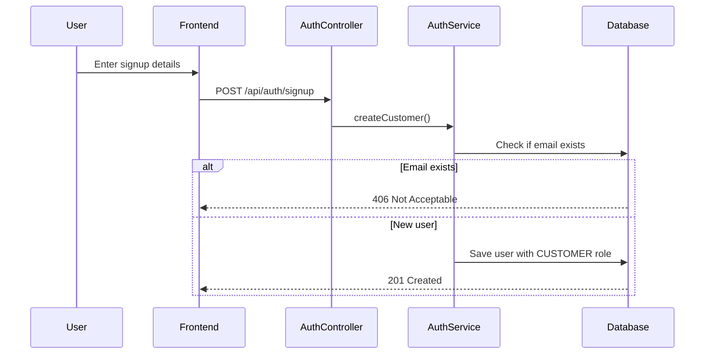
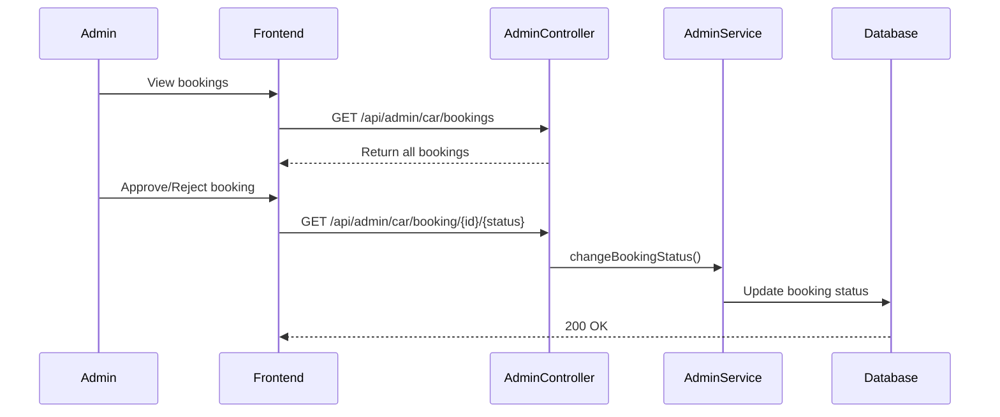
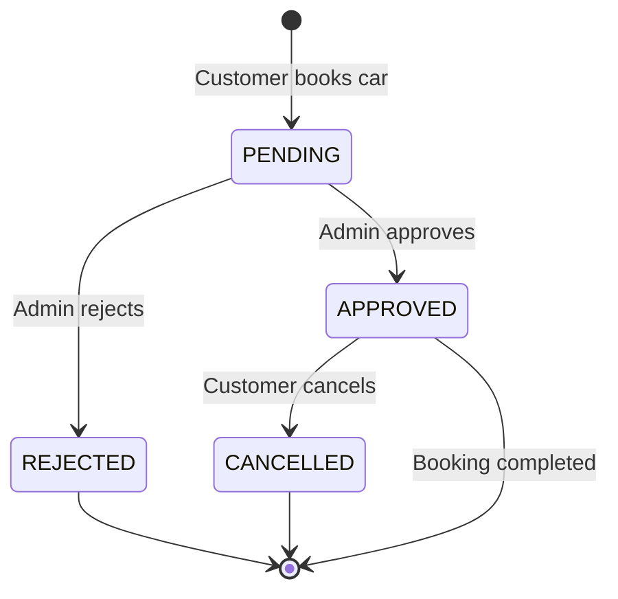

# Car Rental System - Complete Project Documentation

## 📋 Project Overview

**Car Rental System** is a full-stack web application that enables users to browse and rent cars online. The system supports two distinct user roles (Admin and Customer) with role-specific features and dashboards.

### Technology Stack

#### Backend
- **Framework**: Spring Boot 3.2.0
- **Language**: Java 17
- **Database**: MySQL 8
- **ORM**: Hibernate/JPA
- **Build Tool**: Maven
- **Server Port**: 7060

#### Frontend
- **Framework**: React 19.2.0 with Vite
- **UI Library**: Ant Design (antd) 6.1.0
- **Routing**: React Router DOM 7.10.1
- **HTTP Client**: Axios 1.13.2
- **Styling**: CSS with custom design system
- **Dev Server Port**: 5173 (default Vite)

---

## 🏗️ System Architecture

### Backend Architecture

The backend follows a **layered architecture** pattern:

```
┌─────────────────────────────────────┐
│       Controllers (REST API)        │
│  AuthController | AdminController   │
│      CustomerController             │
└──────────────┬──────────────────────┘
               │
┌──────────────▼──────────────────────┐
│          Service Layer              │
│   AuthService | AdminService        │
│      CustomerService                │
└──────────────┬──────────────────────┘
               │
┌──────────────▼──────────────────────┐
│       Repository Layer (JPA)        │
│  UserRepository | CarRepository     │
│      BookingRepository              │
└──────────────┬──────────────────────┘
               │
┌──────────────▼──────────────────────┐
│         MySQL Database              │
│   users | cars | bookings           │
└─────────────────────────────────────┘
```

### Database Schema

#### **Users Table**
| Field    | Type         | Constraints           |
|----------|--------------|----------------------|
| id       | BIGINT       | Primary Key, Auto    |
| name     | VARCHAR      | Not Null             |
| email    | VARCHAR      | Unique, Not Null     |
| password | VARCHAR      | Not Null             |
| role     | ENUM         | CUSTOMER/ADMIN       |

#### **Cars Table**
| Field         | Type         | Constraints          |
|---------------|--------------|---------------------|
| id            | BIGINT       | Primary Key, Auto   |
| brand         | VARCHAR      | Not Null            |
| model         | VARCHAR      | Not Null            |
| color         | VARCHAR      |                     |
| transmission  | VARCHAR      |                     |
| fuel_type     | VARCHAR      |                     |
| year          | INT          |                     |
| price_per_day | DECIMAL      | Not Null            |
| description   | TEXT(1000)   |                     |
| image_url     | VARCHAR      |                     |
| available     | BOOLEAN      | Default: true       |

#### **Bookings Table**
| Field          | Type      | Constraints                    |
|----------------|-----------|--------------------------------|
| id             | BIGINT    | Primary Key, Auto              |
| user_id        | BIGINT    | Foreign Key → users(id)        |
| car_id         | BIGINT    | Foreign Key → cars(id)         |
| from_date      | DATE      | Not Null                       |
| to_date        | DATE      | Not Null                       |
| days           | BIGINT    | Calculated                     |
| price          | DOUBLE    | Total booking price            |
| booking_status | ENUM      | PENDING/APPROVED/REJECTED/CANCELLED |

---

## 🎭 User Roles & Features

### 👤 Customer Role

**Access**: After signup/login as a customer

#### Features:
1. **Browse Cars** - View all available cars with details
2. **Book a Car** - Select dates and book available cars
3. **View Bookings** - See all personal booking history with status
4. **Dashboard** - Personalized view of available cars

#### Customer Workflow:
```
Signup → Login → Browse Cars → Select Car → 
Choose Dates → Confirm Booking → View Booking Status
```

### 👨‍💼 Admin Role

**Default Admin Credentials** (auto-created on first run):
- **Email**: `admin@carrentalx.com`
- **Password**: `admin123`

#### Features:
1. **Car Management**
   - Add new cars to inventory
   - Update existing car details
   - Delete cars from system
   - View all cars

2. **Booking Management**
   - View all customer bookings
   - Approve/Reject booking requests
   - Change booking status

3. **Dashboard** - Overview of all cars in the system

#### Admin Workflow:
```
Login → Manage Cars (Add/Edit/Delete) → 
View All Bookings → Approve/Reject Bookings
```

---

## 🔌 API Endpoints

### Authentication Endpoints (`/api/auth`)

| Method | Endpoint           | Description          | Access  |
|--------|-------------------|----------------------|---------|
| POST   | `/signup`         | Register customer    | Public  |
| POST   | `/login`          | User login           | Public  |
| POST   | `/admin/signup`   | Register admin       | Public  |

### Admin Endpoints (`/api/admin`)

| Method | Endpoint                        | Description              |
|--------|---------------------------------|--------------------------|
| POST   | `/car`                          | Add new car              |
| GET    | `/cars`                         | Get all cars             |
| GET    | `/car/{id}`                     | Get car by ID            |
| PUT    | `/car/{id}`                     | Update car               |
| DELETE | `/car/{id}`                     | Delete car               |
| GET    | `/car/bookings`                 | Get all bookings         |
| GET    | `/car/booking/{bookingId}/{status}` | Change booking status |

### Customer Endpoints (`/api/customer`)

| Method | Endpoint                  | Description                    |
|--------|---------------------------|--------------------------------|
| GET    | `/cars`                   | Get all available cars         |
| GET    | `/car/{id}`               | Get car details                |
| POST   | `/car/book`               | Book a car                     |
| GET    | `/car/bookings/{userId}`  | Get user's bookings            |

---

## 🎨 Frontend Structure

### Page Routes

#### Public Routes
- `/` - Home page
- `/login` - Login page
- `/signup` - Signup page

#### Admin Routes
- `/admin/dashboard` - Admin dashboard (car list)
- `/admin/add-car` - Add new car form
- `/admin/car/:id` - Update car form
- `/admin/bookings` - View all bookings

#### Customer Routes
- `/customer/dashboard` - Customer dashboard (available cars)
- `/customer/book/:id` - Book car page
- `/customer/bookings` - My bookings page

### Components

1. **Navbar** - Navigation bar with role-based menu items
2. **Footer** - Footer with company information
3. **Protected Routes** - Role-based route protection

### Services

- **API Service** - Centralized Axios configuration for backend communication

---

## 🔄 Key Workflows

### 1. User Registration & Authentication



### 2. Car Booking Process

```mermaid
sequenceDiagram
    participant Customer
    participant Frontend
    participant CustomerController
    participant CustomerService
    participant Database

    Customer->>Frontend: Select car & dates
    Frontend->>CustomerController: POST /api/customer/car/book
    CustomerController->>CustomerService: bookACar()
    CustomerService->>Database: Create booking (PENDING status)
    CustomerService->>Database: Update car availability
    Database-->>Frontend: 201 Created
    Frontend-->>Customer: Booking confirmed
```



### 3. Admin Booking Approval



---

## 🌱 Data Seeding

The application includes a **DataSeeder** component that automatically initializes the database on startup:

### Default Data Created:

1. **Admin User**
   - Email: `admin@carrentalx.com`
   - Password: `admin123`
   - Role: ADMIN

2. **Car Inventory** (22 cars total)
   - **10 SUVs**: Tata Nexon, Hyundai Creta, Mahindra Thar, Scorpio, XUV700, Tata Punch, Maruti Brezza, Kia Seltos, Kia Sonet, Toyota Fortuner
   - **8 Sedans**: Maruti Dzire, Hyundai Verna, Honda City, VW Virtus, Skoda Slavia, Honda Amaze, Hyundai Aura, Maruti Ciaz
   - **4 Electric**: Tata Nexon EV, Tata Tiago EV, MG Comet EV, Mahindra XUV400

> **Note**: Existing bookings and cars are cleared on each restart to ensure fresh data.

---

## 🔐 Security & Authentication

### Current Implementation:
- **Password Storage**: Plain text (⚠️ Not production-ready)
- **Authentication**: Simple email/password validation
- **CORS**: Enabled for all origins (`@CrossOrigin("*")`)

### Recommended Improvements:
- Implement password hashing (BCrypt)
- Add JWT token-based authentication
- Implement proper session management
- Restrict CORS to specific origins
- Add input validation and sanitization

---

## 📊 Booking Status Flow



**Status Definitions**:
- **PENDING**: Booking created, awaiting admin approval
- **APPROVED**: Admin approved, booking confirmed
- **REJECTED**: Admin rejected the booking request
- **CANCELLED**: Customer or admin cancelled the booking

---

## 🚀 Running the Application

### Prerequisites:
- Java 17+
- Node.js 18+
- MySQL 8+
- Maven (optional, can use JAR)

### Backend Setup:

1. **Configure Database** (`application.properties`):
   ```properties
   spring.datasource.url=jdbc:mysql://localhost:3306/car_rental_db
   spring.datasource.username=root
   spring.datasource.password=root
   ```

2. **Start Backend**:
   - **Option 1**: Double-click `run_backend.bat` (Windows)
   - **Option 2**: Run JAR directly: `java -jar target/backend-0.0.1-SNAPSHOT.jar`
   - **Option 3**: Maven: `mvn spring-boot:run`

3. Backend runs on: `http://localhost:7060`

### Frontend Setup:

1. **Install Dependencies**:
   ```bash
   cd frontend
   npm install
   ```

2. **Start Frontend**:
   - **Option 1**: Double-click `start-frontend.bat` (Windows)
   - **Option 2**: Run: `npm run dev`

3. Frontend runs on: `http://localhost:5173`

### Quick Start (Both Services):
- Double-click `start-all.bat` in the root directory

---

## 📁 Project Structure

```
CarRentalSystem/
├── backend/
│   ├── src/main/java/com/carrental/
│   │   ├── CarRentalApplication.java
│   │   ├── configuration/
│   │   │   └── DataSeeder.java
│   │   ├── controller/
│   │   │   ├── AuthController.java
│   │   │   ├── AdminController.java
│   │   │   └── CustomerController.java
│   │   ├── dto/
│   │   │   ├── UserDto.java
│   │   │   ├── CarDto.java
│   │   │   ├── BookACarDto.java
│   │   │   ├── SignupRequest.java
│   │   │   └── LoginRequest.java
│   │   ├── entity/
│   │   │   ├── User.java
│   │   │   ├── Car.java
│   │   │   └── Booking.java
│   │   ├── enums/
│   │   │   ├── UserRole.java
│   │   │   └── BookingStatus.java
│   │   ├── repository/
│   │   │   ├── UserRepository.java
│   │   │   ├── CarRepository.java
│   │   │   └── BookingRepository.java
│   │   └── service/
│   │       ├── AuthService.java
│   │       ├── AuthServiceImpl.java
│   │       ├── AdminService.java
│   │       ├── AdminServiceImpl.java
│   │       ├── CustomerService.java
│   │       └── CustomerServiceImpl.java
│   ├── src/main/resources/
│   │   └── application.properties
│   ├── pom.xml
│   └── run_backend.bat
├── frontend/
│   ├── src/
│   │   ├── components/
│   │   │   ├── Navbar.jsx
│   │   │   └── Footer.jsx
│   │   ├── pages/
│   │   │   ├── Home.jsx
│   │   │   ├── auth/
│   │   │   │   ├── Login.jsx
│   │   │   │   └── Signup.jsx
│   │   │   ├── admin/
│   │   │   │   ├── AdminDashboard.jsx
│   │   │   │   ├── AddCar.jsx
│   │   │   │   ├── UpdateCar.jsx
│   │   │   │   └── AdminBookings.jsx
│   │   │   └── customer/
│   │   │       ├── CustomerDashboard.jsx
│   │   │       ├── BookCar.jsx
│   │   │       └── MyBookings.jsx
│   │   ├── services/
│   │   ├── App.jsx
│   │   ├── main.jsx
│   │   └── index.css
│   ├── package.json
│   ├── vite.config.js
│   └── start-frontend.bat
└── start-all.bat
```

---

## 🎯 Key Features Summary

### ✅ Implemented Features

1. **User Management**
   - Customer registration and login
   - Admin account with default credentials
   - Role-based access control

2. **Car Management**
   - CRUD operations for cars (Admin only)
   - Car availability tracking
   - Detailed car information (brand, model, price, specs)

3. **Booking System**
   - Date-based car booking
   - Automatic price calculation
   - Booking status management
   - Admin approval workflow

4. **UI/UX**
   - Responsive design with Ant Design
   - Role-specific dashboards
   - Navigation with React Router
   - Modern, clean interface

5. **Data Initialization**
   - Automatic database seeding
   - Pre-loaded car inventory (22 cars)
   - Default admin account

### 🔮 Potential Enhancements

1. **Security**: JWT authentication, password encryption
2. **Payment Integration**: Online payment gateway
3. **Search & Filters**: Advanced car search by brand, type, price
4. **Notifications**: Email/SMS booking confirmations
5. **Reviews**: Customer reviews and ratings
6. **Analytics**: Admin dashboard with booking statistics
7. **Multi-language**: Internationalization support
8. **Mobile App**: React Native mobile application

---

## 🐛 Troubleshooting

### Backend Issues:
- **Database Connection Error**: Ensure MySQL is running and credentials are correct
- **Port 7060 in use**: Change `server.port` in `application.properties`
- **Maven not found**: Use the pre-built JAR file instead

### Frontend Issues:
- **PowerShell execution policy**: Use the provided `.bat` files
- **Port 5173 in use**: Vite will automatically use the next available port
- **API connection failed**: Verify backend is running on port 7060

---

## 📝 Notes

- The application uses **plain text passwords** - not suitable for production
- **CORS is open** to all origins - restrict in production
- Database is **auto-created** if it doesn't exist
- Car data is **reseeded** on every application restart
- All car images use **Unsplash** placeholder URLs
